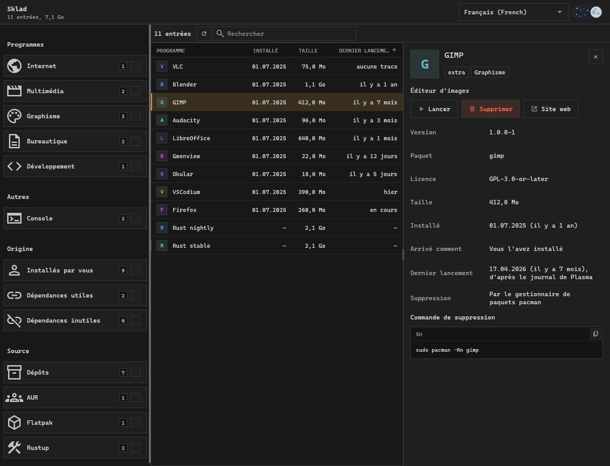
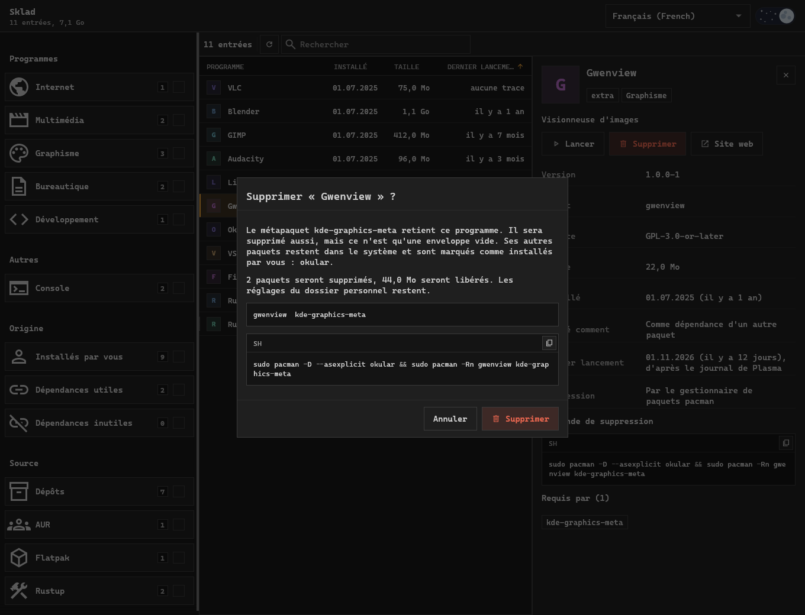
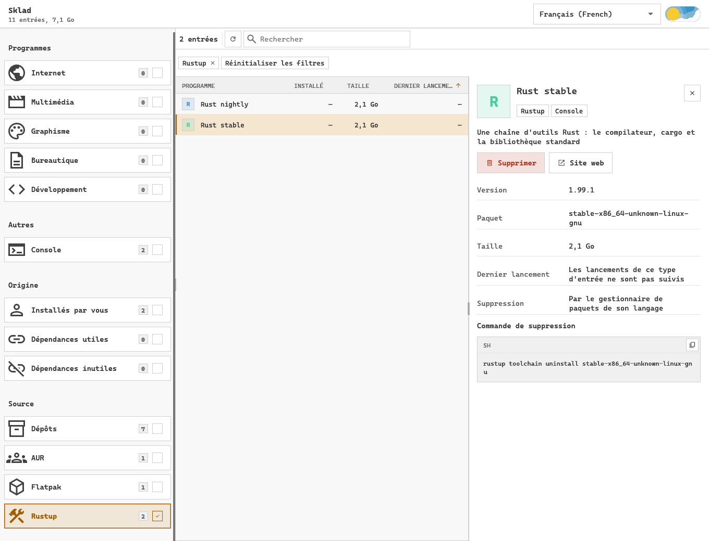

<div align="center">


# Sklad

**Une application de bureau pour Arch Linux, Debian et Ubuntu qui montre tout ce qui est installé, quelle qu'en soit la source, et supprime ce dont vous ne vous servez plus.**

[](LICENSE)
[](https://github.com/pavver/sklad/actions/workflows/ci.yml)


Site : [English](https://pavver.github.io/sklad/) · [Українська](https://pavver.github.io/sklad/uk.html) · [Français](https://pavver.github.io/sklad/fr.html) · [Русский](https://pavver.github.io/sklad/ru.html)

Readme : [English](README.md) · [Українська](README.uk.md) · **Français** · [Русский](README.ru.md)



</div>

Les gestionnaires de paquets ne connaissent que ce qu'ils ont installé eux-mêmes.
Sklad réunit en une seule liste les paquets pacman, AUR et apt, les applications Flatpak, les jeux Steam, les chaînes d'outils Rust, les outils Cargo, npm et Python, les environnements Python, les conteneurs, images et volumes Docker, et les fichiers installés hors gestionnaire.
Triez-la par dernier lancement pour trouver ce qui ne sert plus, lisez ce qu'est chaque entrée, et désinstallez-la avec une commande que vous voyez avant qu'elle ne s'exécute.
C'est une façon graphique de trouver les paquets inutilisés, les dépendances orphelines, les outils de développement oubliés, les vieux environnements virtuels et images Docker, et de libérer de l'espace disque sur Arch Linux, Debian et Ubuntu.

> [!WARNING]
> Version précoce.
> Les tests utilisent un faux backend et n'effectuent jamais de vraie suppression : lisez la commande affichée dans la fenêtre avant de confirmer.
> Testé sur Arch Linux avec KDE Plasma sous Wayland ; sur Debian et Ubuntu, le catalogue et les plans de suppression sont vérifiés avec apt dans des conteneurs.

## Fonctionnalités

- **Un seul catalogue** de programmes, outils en console, bibliothèques, polices, pilotes et métapaquets.
- **Au-delà des paquets :** les projets Docker Compose et les conteneurs, chacun sur une ligne avec les images et volumes que lui seul utilise et supprimé avec eux, tandis que les images et volumes que rien n'utilise ressortent comme des restes ; et les environnements Python de virtualenvwrapper, pyenv, conda et mamba.
- **Des détails pour chaque entrée :** icône, description, licence, site web, développeur, taille, date d'installation.
- **Dernier lancement** d'après le journal de Plasma et Steam, pour faire ressortir ce que vous n'utilisez plus.
- **Filtres** en tuiles dans la barre latérale, chacune avec le nombre d'entrées qu'elle afficherait : sections, sources et origine (installés par vous, dépendances utiles, dépendances inutiles ou orphelines). Les filtres actifs apparaissent en puces au-dessus de la liste, à côté de la recherche.
- **Suppression hors d'un métapaquet :** le programme part, le reste du métapaquet reste.
- **Rien de caché :** la commande exacte est à l'écran et peut être copiée au lieu d'être exécutée.
- **Lancement** d'un programme depuis sa fiche, et sélection et copie de tout texte de la fenêtre.
- **Ukrainien, anglais, français et russe**, thèmes clair et sombre.

## Ce qu'il trouve

| Source | Où il cherche | Comment une entrée est supprimée |
| --- | --- | --- |
| Dépôts, AUR | la base de données de pacman | `pacman -Rn` avec une liste vérifiée |
| Dépôts, paquets locaux | la base de données de dpkg, avec apt pour la suite | `apt-get remove` avec une liste vérifiée |
| Flatpak | installations système et utilisateur | `flatpak uninstall`, avec un mot de passe pour celles du système |
| Steam | manifestes de la bibliothèque | le client Steam s'ouvre et demande |
| Cargo | enregistrements de `cargo install` | `cargo uninstall` |
| Node.js | paquets globaux npm et pnpm | `npm uninstall -g`, `pnpm remove -g` |
| Python | `pip --user`, pipx, outils uv, interpréteurs uv | le gestionnaire qui l'a installé |
| Environnements Python | environnements virtualenvwrapper, pyenv, conda et mamba | le dossier entier à la corbeille |
| Rustup | chaînes d'outils | `rustup toolchain uninstall` |
| Docker | conteneurs, images et volumes | `docker container rm`, `docker image rm`, `docker volume rm` |
| Hors gestionnaire | `~/.local/bin`, `/usr/local/bin`, `/opt`, vos lanceurs | fichiers du dossier personnel à la corbeille, fichiers système définitivement |

Les enregistrements Python du dossier système qu'aucun paquet ne possède sont affichés, mais leur suppression depuis Sklad est désactivée.

## Suppression sûre



1. La liste des paquets est calculée sur le graphe des dépendances, selon les mêmes règles que `pacman -Rs` ou `apt-get remove --auto-remove`.
2. Un métapaquet est supprimé avec le programme.
   Les autres paquets qu'il contient sont marqués comme installés par vous et restent dans le système.
3. `pacman -Rp` ou `apt-get -s remove` vérifie la liste avant toute action.
   Si les listes diffèrent, l'action s'arrête.
4. Le gestionnaire de paquets reçoit les paquets par leur nom : seul ce que montre la fenêtre est supprimé.
5. Les paquets système importants et les fichiers hors du dossier personnel demandent une confirmation à part.

## Outils des langages



Les chaînes d'outils et les paquets globaux occupent des gigaoctets sans apparaître dans aucune liste de paquets.
Sklad les montre à côté de tout le reste et prévient avant de supprimer ce dont d'autres dépendent, comme la chaîne d'outils Rust par défaut.

## Installation

### Arch Linux

Sklad a son propre dépôt pacman, avec des paquets signés par la clé `EB0FE0C7F0FEBBD1A40F8F93A7A3ED14D1C98D8D`.
Faites confiance à la clé une fois :

```sh
curl -sL https://pavver.github.io/sklad/sklad.asc | sudo pacman-key --add -
sudo pacman-key --lsign-key EB0FE0C7F0FEBBD1A40F8F93A7A3ED14D1C98D8D
```

Ajoutez le dépôt à `/etc/pacman.conf` ; la commande ne fait rien s'il y est déjà :

```sh
grep -q '^\[sklad\]' /etc/pacman.conf ||
  printf '\n[sklad]\nServer = https://pavver.github.io/sklad/$arch\n' | sudo tee -a /etc/pacman.conf >/dev/null
```

Puis installez-le ; les mises à jour arrivent avec `pacman -Syu` :

```sh
sudo pacman -Sy sklad
```

### Debian et Ubuntu

Sklad a son propre dépôt apt, signé par la même clé.
Il faut Debian 12, Ubuntu 22.04 ou plus récent.
Faites confiance à la clé et ajoutez le dépôt ; relancer les commandes ne change rien :

```sh
curl -fsSL https://pavver.github.io/sklad/sklad.asc | sudo gpg --dearmor --yes -o /usr/share/keyrings/sklad.gpg
echo 'deb [signed-by=/usr/share/keyrings/sklad.gpg] https://pavver.github.io/sklad/debian ./' |
  sudo tee /etc/apt/sources.list.d/sklad.list >/dev/null
```

Puis installez-le ; les mises à jour arrivent avec `apt upgrade` :

```sh
sudo apt update && sudo apt install sklad
```

### Depuis les sources

Il faut Rust ; les suppressions qui demandent un mot de passe ont besoin de `polkit`.

```sh
git clone https://github.com/pavver/sklad
cd sklad
cargo install --path .
install -Dm644 packaging/sklad.desktop ~/.local/share/applications/sklad.desktop
install -Dm644 assets/sklad.svg ~/.local/share/icons/hicolor/scalable/apps/sklad.svg
```

Ou lancez-le sans l'installer :

```sh
cargo run --release
```

## Comparaison avec d'autres outils

- `pacman -Qdtq` et `apt autoremove` trouvent les dépendances orphelines, mais pas les programmes que vous avez installés puis cessé d'utiliser.
- Pamac, Octopi et Synaptic gèrent les paquets de la distribution ; Sklad liste aussi Flatpak, Steam et les gestionnaires de paquets des langages, et trie le tout par dernier lancement.
- BleachBit nettoie les caches et les fichiers temporaires ; Sklad supprime des programmes entiers par le gestionnaire qui les a installés.

## Bon à savoir

- Plasma n'enregistre que les lancements depuis le menu, le panneau et KRunner : « aucun enregistrement » ne veut donc pas dire qu'un programme est inutilisé.
  Les lancements des programmes en console ne sont pas suivis.
- Les tailles sont celles des fichiers.
  Sur un système de fichiers compressé comme ZFS, moins d'espace est libéré.
- La langue vient du système.
  Le choix de la langue dans l'en-tête la change et la mémorise dans `~/.config/sklad/language`.
  Une langue se trouve par son propre nom ou par son nom anglais.
  Les descriptions suivent la langue, le catalogue est donc relu.

## Contribuer

Les modifications passent par des pull requests, voir [CONTRIBUTING.md](CONTRIBUTING.md).

## Licence

[MIT](LICENSE).
L'interface suit le système de design [Operator UI](https://github.com/pavver/operator-design-system).
Les ressources tierces (la police Cascadia Code, les icônes Material Symbols, l'interrupteur jour/nuit) gardent leurs propres licences, listées dans [NOTICE.md](NOTICE.md).
