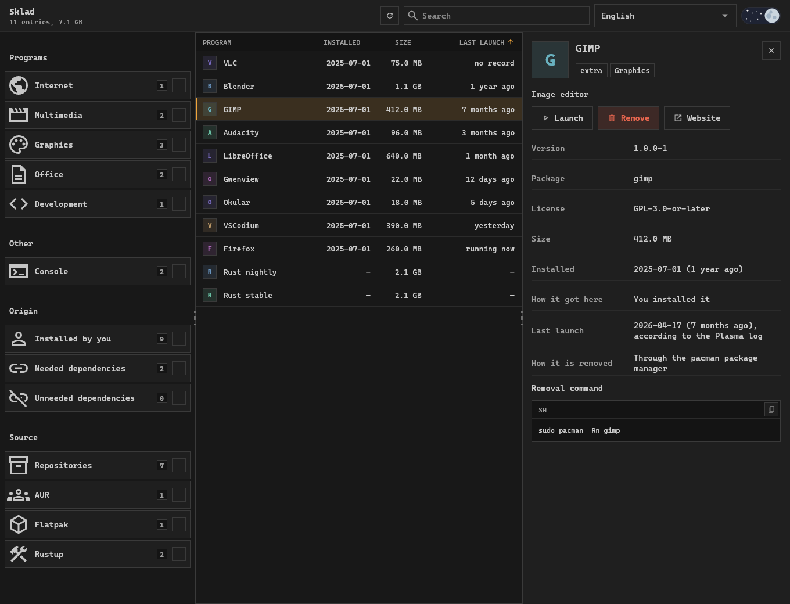
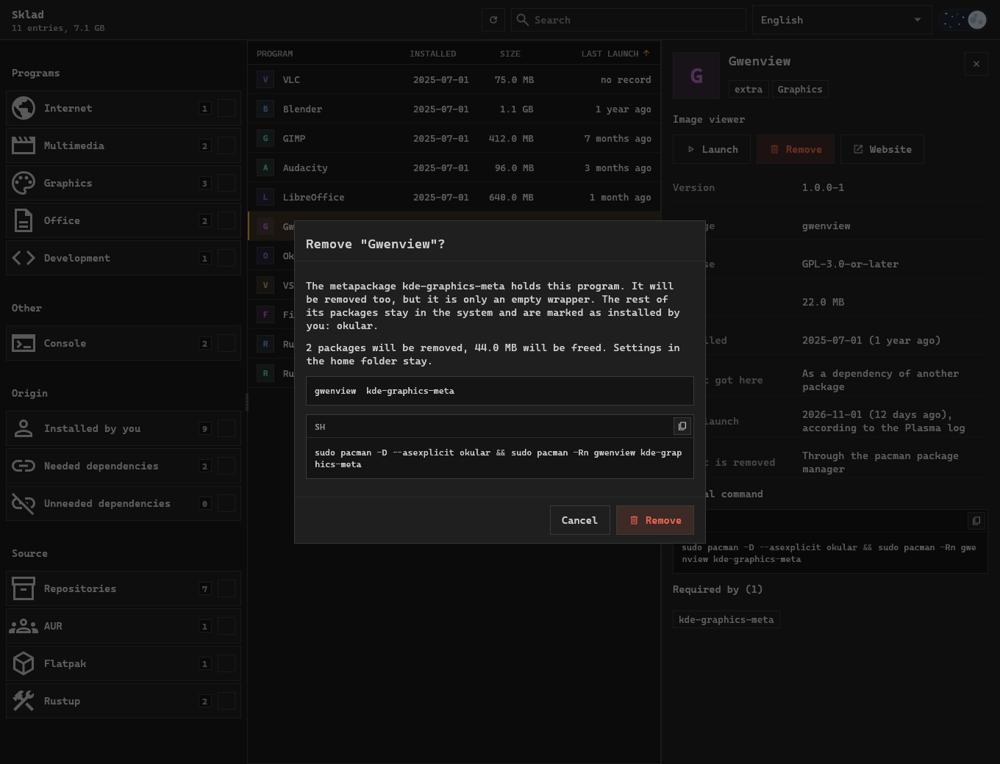
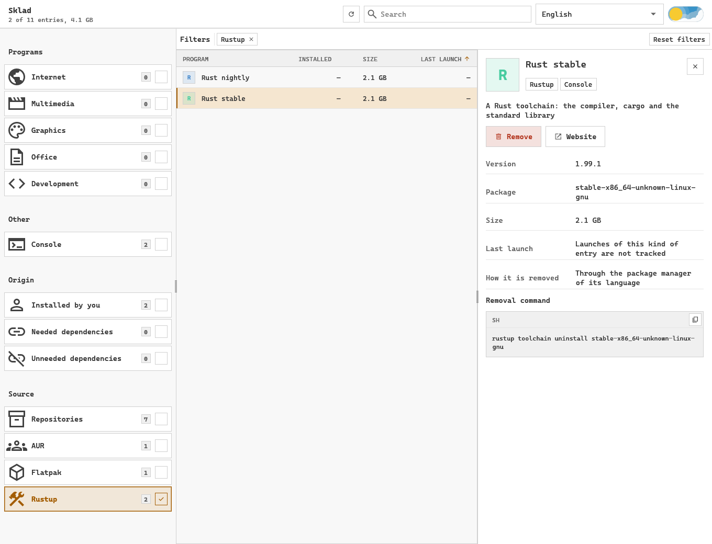

<div align="center">


# Sklad

**A desktop app for Arch Linux, Debian and Ubuntu that shows everything installed, from any source, and removes what you no longer use.**

[](LICENSE)
[](https://github.com/pavver/sklad/actions/workflows/ci.yml)


[Website](https://pavver.github.io/sklad/) · [Українська](README.uk.md) · [Site en français](https://pavver.github.io/sklad/fr.html) · [Сайт на русском](https://pavver.github.io/sklad/ru.html)



</div>

Package managers only tell you what they installed themselves.
Sklad puts pacman, AUR and apt packages, Flatpak apps, Steam games, Rust toolchains, Cargo, npm and Python tools, Python environments, Docker containers, images and volumes, and loose files in one list.
Sort it by last launch to find what has gone unused, read what each entry is, and uninstall it with a command you see before it runs.
It is a graphical way to find unused packages, orphan dependencies, forgotten developer tools, old virtual environments and Docker images, and to free disk space on Arch Linux, Debian and Ubuntu.

> [!WARNING]
> Early version.
> Tests use a fake backend and never run a real removal, so read the command the window shows before you confirm it.
> Tested on Arch Linux with KDE Plasma on Wayland; on Debian and Ubuntu the catalogue and the removal plans are checked against apt in containers.

## Features

- **One catalogue** of programs, console tools, libraries, fonts, drivers and metapackages.
- **Beyond packages:** Docker containers, images and volumes with their size and what uses them, and the Python environments of virtualenvwrapper, pyenv, conda and mamba.
- **Details for each entry:** icon, description, license, website, developer, size, install date.
- **Last launch** from the Plasma log and Steam, to surface what you stopped using.
- **Filters:** by section, by source, packages you installed yourself, dependencies, unneeded dependencies (orphans), and search.
- **Removal out of a metapackage:** the program goes, the rest of the metapackage stays.
- **Nothing hidden:** the exact command is on screen and can be copied instead of run.
- **Launch** a program from its card, and select and copy any text in the window.
- **Ukrainian, English, French and Russian**, light and dark themes.

## What it finds

| Source | Where it looks | How an entry is removed |
| --- | --- | --- |
| Repositories, AUR | the pacman database | `pacman -Rn` with a checked list |
| Repositories, local packages | the dpkg database, with apt for the suite | `apt-get remove` with a checked list |
| Flatpak | system and user installations | `flatpak uninstall`, with a password for system ones |
| Steam | library manifests | the Steam client opens and asks |
| Cargo | `cargo install` records | `cargo uninstall` |
| Node.js | npm and pnpm global packages | `npm uninstall -g`, `pnpm remove -g` |
| Python | `pip --user`, pipx, uv tools, uv interpreters | the manager that installed it |
| Python environments | virtualenvwrapper, pyenv, conda and mamba environments | the whole folder to the bin |
| Rustup | toolchains | `rustup toolchain uninstall` |
| Docker | containers, images and volumes | `docker container rm`, `docker image rm`, `docker volume rm` |
| Outside managers | `~/.local/bin`, `/usr/local/bin`, `/opt`, your launchers | home files to the bin, system files for good |

Python records in the system folder that no package owns are shown, but removing them from here is off.

## Safe removal



1. The list of packages is computed on the dependency graph by the same rules as `pacman -Rs` or `apt-get remove --auto-remove`.
2. A metapackage is removed together with the program.
   The rest of its packages are marked as installed by you and stay in the system.
3. `pacman -Rp` or `apt-get -s remove` checks the list before anything happens.
   If the lists differ, the action stops.
4. The package manager receives the packages by name, so only what the window shows is removed.
5. Important system packages and files outside the home folder need a separate confirmation.

## Language tools



Toolchains and global packages take gigabytes without appearing in any package list.
Sklad shows them next to everything else and warns before removing something others rely on, such as the default Rust toolchain.

## Install

### Arch Linux

Sklad has its own pacman repository, with packages signed by the key `EB0FE0C7F0FEBBD1A40F8F93A7A3ED14D1C98D8D`.
Trust the key once:

```sh
curl -sL https://pavver.github.io/sklad/sklad.asc | sudo pacman-key --add -
sudo pacman-key --lsign-key EB0FE0C7F0FEBBD1A40F8F93A7A3ED14D1C98D8D
```

Add the repository to `/etc/pacman.conf`; the command does nothing if it is already there:

```sh
grep -q '^\[sklad\]' /etc/pacman.conf ||
  printf '\n[sklad]\nServer = https://pavver.github.io/sklad/$arch\n' | sudo tee -a /etc/pacman.conf >/dev/null
```

Then install it; updates come with `pacman -Syu`:

```sh
sudo pacman -Sy sklad
```

### Debian and Ubuntu

Sklad has its own apt repository, signed by the same key.
It needs Debian 12, Ubuntu 22.04 or newer.
Trust the key and add the repository; running the commands again changes nothing:

```sh
curl -fsSL https://pavver.github.io/sklad/sklad.asc | sudo gpg --dearmor --yes -o /usr/share/keyrings/sklad.gpg
echo 'deb [signed-by=/usr/share/keyrings/sklad.gpg] https://pavver.github.io/sklad/debian ./' |
  sudo tee /etc/apt/sources.list.d/sklad.list >/dev/null
```

Then install it; updates come with `apt upgrade`:

```sh
sudo apt update && sudo apt install sklad
```

### From source

You need Rust; removals that ask for a password need `polkit`.

```sh
git clone https://github.com/pavver/sklad
cd sklad
cargo install --path .
install -Dm644 packaging/sklad.desktop ~/.local/share/applications/sklad.desktop
install -Dm644 assets/sklad.svg ~/.local/share/icons/hicolor/scalable/apps/sklad.svg
```

Or run it without installing:

```sh
cargo run --release
```

## Compared with other tools

- `pacman -Qdtq` and `apt autoremove` find orphan dependencies, but not the programs you installed and stopped using.
- Pamac, Octopi and Synaptic manage the packages of the distribution; Sklad also lists Flatpak, Steam and language package managers, and sorts everything by last launch.
- BleachBit cleans caches and temporary files; Sklad removes whole programs through the manager that installed them.

## Good to know

- Plasma records launches from the menu, the panel and KRunner only, so "no record" does not mean a program is unused.
  Launches of console programs are not tracked.
- Sizes are the size of the files.
  On a compressed file system such as ZFS, less space is freed.
- The language comes from the system.
  The language choice in the header switches it and remembers it in `~/.config/sklad/language`.
  A language is found by its own name or by its English one.
  Descriptions follow the language, so the catalogue is read again.

## Contributing

Changes come through pull requests, see [CONTRIBUTING.md](CONTRIBUTING.md).

## License

[MIT](LICENSE).
The interface follows the [Operator UI](https://github.com/pavver/operator-design-system) design system.
Third-party assets (the Cascadia Code font, Material Symbols icons, the day/night toggle) keep their own licenses, listed in [NOTICE.md](NOTICE.md).
