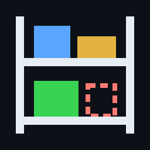
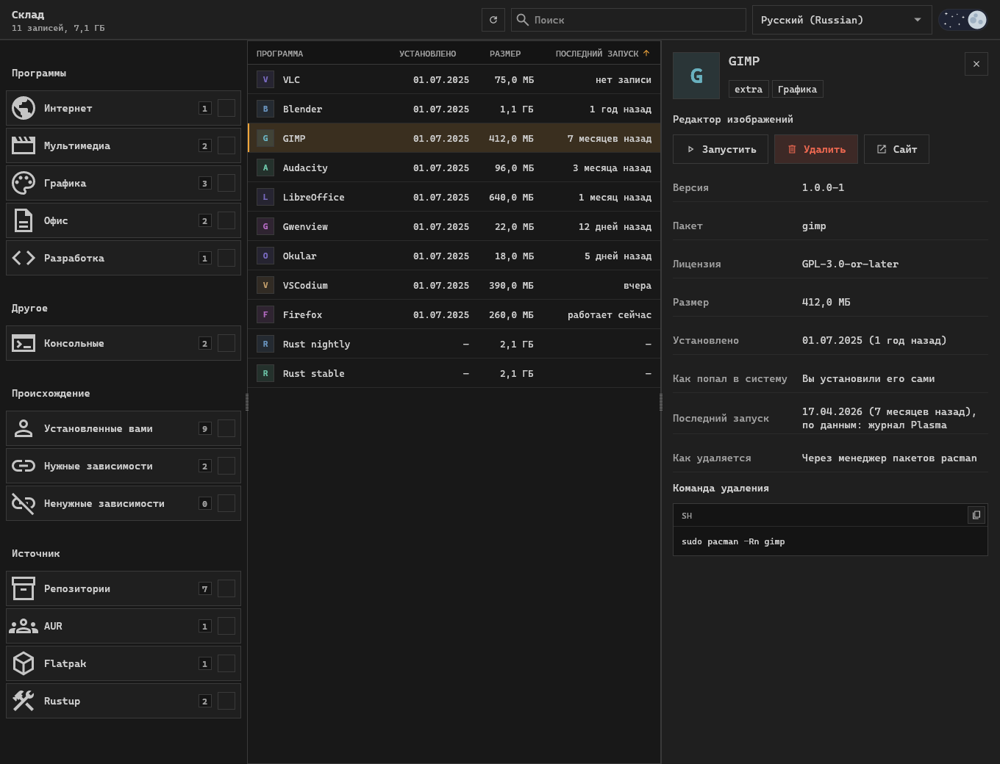
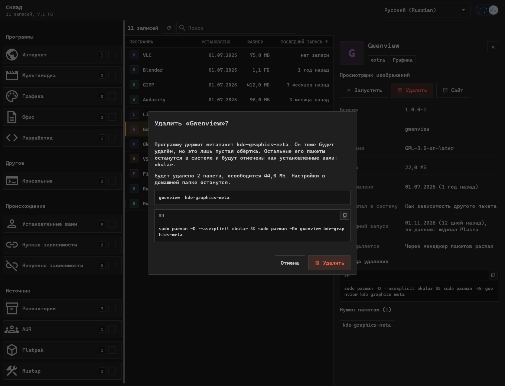
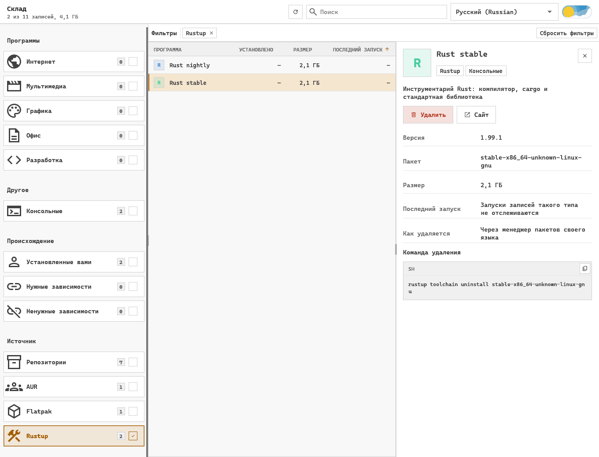

<div align="center">



# Склад

**Программа для Arch Linux, Debian и Ubuntu, которая показывает всё установленное из любого источника и удаляет то, чем вы больше не пользуетесь.**

[](LICENSE)
[](https://github.com/pavver/sklad/actions/workflows/ci.yml)


Сайт: [English](https://pavver.github.io/sklad/) · [Українська](https://pavver.github.io/sklad/uk.html) · [Français](https://pavver.github.io/sklad/fr.html) · [Русский](https://pavver.github.io/sklad/ru.html)

Readme: [English](README.md) · [Українська](README.uk.md) · [Français](README.fr.md) · **Русский**



</div>

Менеджеры пакетов знают только то, что установили сами.
Склад собирает в один список пакеты pacman, AUR и apt, приложения Flatpak, игры Steam, инструментарии Rust, инструменты Cargo, npm и Python, окружения Python, контейнеры, образы и тома Docker и файлы вне менеджеров.
Отсортируйте его по последнему запуску, чтобы найти неиспользуемое, прочитайте, что это такое, и удалите командой, которую видно ещё до запуска.
Так удобно искать ненужные пакеты, осиротевшие зависимости, забытые инструменты разработчика, старые виртуальные окружения и образы Docker и освобождать место на диске в Arch Linux, Debian и Ubuntu.

> [!WARNING]
> Ранняя версия.
> Тесты используют подменённый бэкенд и никогда не выполняют настоящего удаления, поэтому читайте команду в окне перед подтверждением.
> Проверено на Arch Linux с KDE Plasma на Wayland; на Debian и Ubuntu каталог и планы удаления проверяются с apt в контейнерах.

## Возможности

- **Один каталог** программ, консольных инструментов, библиотек, шрифтов, драйверов и метапакетов.
- **Не только пакеты:** проекты Docker Compose и контейнеры, каждый одной строкой вместе с образами и томами, которые использует только он, и удаляется вместе с ними, а образы и тома, которыми никто не пользуется, видны как остатки; и окружения Python из virtualenvwrapper, pyenv, conda и mamba.
- **Подробности о каждой записи:** иконка, описание, лицензия, сайт, разработчик, размер, дата установки.
- **Последний запуск** по журналу Plasma и Steam, чтобы выделить то, чем вы перестали пользоваться.
- **Фильтры:** по разделу, по источнику, пакеты, установленные вами, зависимости, ненужные зависимости (сироты) и поиск.
- **Удаление из метапакета:** программа уходит, остальное из метапакета остаётся.
- **Ничего скрытого:** точная команда на экране, её можно скопировать вместо запуска.
- **Запуск** программы из её карточки, выделение и копирование любого текста в окне.
- **Украинский, английский, французский и русский**, светлая и тёмная темы.

## Что он находит

| Источник | Где он ищет | Как удаляется запись |
| --- | --- | --- |
| Репозитории, AUR | база данных pacman | `pacman -Rn` с проверенным списком |
| Репозитории, локальные пакеты | база данных dpkg, с apt для набора | `apt-get remove` с проверенным списком |
| Flatpak | системные и пользовательские установки | `flatpak uninstall`, с паролем для системных |
| Steam | манифесты библиотеки | клиент Steam открывается и спрашивает |
| Cargo | записи `cargo install` | `cargo uninstall` |
| Node.js | глобальные пакеты npm и pnpm | `npm uninstall -g`, `pnpm remove -g` |
| Python | `pip --user`, pipx, инструменты uv, интерпретаторы uv | менеджер, который его установил |
| Окружения Python | окружения virtualenvwrapper, pyenv, conda и mamba | вся папка в корзину |
| Rustup | инструментарии | `rustup toolchain uninstall` |
| Docker | контейнеры, образы и тома | `docker container rm`, `docker image rm`, `docker volume rm` |
| Вне менеджеров | `~/.local/bin`, `/usr/local/bin`, `/opt`, ваши ярлыки | файлы из домашней папки в корзину, системные навсегда |

Записи Python в системной папке, которыми не владеет ни один пакет, показываются, но удалять их отсюда нельзя.

## Безопасное удаление



1. Список пакетов вычисляется по графу зависимостей по тем же правилам, что и `pacman -Rs` или `apt-get remove --auto-remove`.
2. Метапакет удаляется вместе с программой.
   Остальные его пакеты помечаются как установленные вами и остаются в системе.
3. `pacman -Rp` или `apt-get -s remove` проверяет список, прежде чем что-либо произойдёт.
   Если списки расходятся, действие останавливается.
4. Менеджер пакетов получает пакеты по имени, поэтому удаляется только то, что показывает окно.
5. Важные системные пакеты и файлы вне домашней папки требуют отдельного подтверждения.

## Инструменты языков



Инструментарии и глобальные пакеты занимают гигабайты, не появляясь ни в одном списке пакетов.
Склад показывает их рядом со всем остальным и предупреждает, прежде чем удалить то, на что опирается другое, например инструментарий Rust по умолчанию.

## Установка

### Arch Linux

У Склада есть свой репозиторий pacman, пакеты в нём подписаны ключом `EB0FE0C7F0FEBBD1A40F8F93A7A3ED14D1C98D8D`.
Один раз доверьтесь ключу:

```sh
curl -sL https://pavver.github.io/sklad/sklad.asc | sudo pacman-key --add -
sudo pacman-key --lsign-key EB0FE0C7F0FEBBD1A40F8F93A7A3ED14D1C98D8D
```

Добавьте репозиторий в `/etc/pacman.conf`; если он уже там, команда ничего не делает:

```sh
grep -q '^\[sklad\]' /etc/pacman.conf ||
  printf '\n[sklad]\nServer = https://pavver.github.io/sklad/$arch\n' | sudo tee -a /etc/pacman.conf >/dev/null
```

Затем установите; обновления приходят с `pacman -Syu`:

```sh
sudo pacman -Sy sklad
```

### Debian и Ubuntu

У Склада есть свой репозиторий apt, подписанный тем же ключом.
Нужен Debian 12, Ubuntu 22.04 или новее.
Доверьтесь ключу и добавьте репозиторий; повторный запуск команд ничего не меняет:

```sh
curl -fsSL https://pavver.github.io/sklad/sklad.asc | sudo gpg --dearmor --yes -o /usr/share/keyrings/sklad.gpg
echo 'deb [signed-by=/usr/share/keyrings/sklad.gpg] https://pavver.github.io/sklad/debian ./' |
  sudo tee /etc/apt/sources.list.d/sklad.list >/dev/null
```

Затем установите; обновления приходят с `apt upgrade`:

```sh
sudo apt update && sudo apt install sklad
```

### Из исходников

Нужен Rust; для удалений, которые спрашивают пароль, нужен `polkit`.

```sh
git clone https://github.com/pavver/sklad
cd sklad
cargo install --path .
install -Dm644 packaging/sklad.desktop ~/.local/share/applications/sklad.desktop
install -Dm644 assets/sklad.svg ~/.local/share/icons/hicolor/scalable/apps/sklad.svg
```

Или запустите без установки:

```sh
cargo run --release
```

## В сравнении с другими инструментами

- `pacman -Qdtq` и `apt autoremove` находят осиротевшие зависимости, но не программы, которые вы установили и перестали использовать.
- Pamac, Octopi и Synaptic управляют пакетами дистрибутива; Склад показывает ещё и Flatpak, Steam и менеджеры пакетов языков и сортирует всё по последнему запуску.
- BleachBit чистит кэши и временные файлы; Склад удаляет программы целиком через менеджер, который их установил.

## Полезно знать

- Plasma записывает только запуски из меню, панели и KRunner, поэтому «нет записи» не значит, что программой не пользуются.
  Запуски консольных программ не отслеживаются.
- Размеры — это размер файлов.
  На сжатой файловой системе, например ZFS, освобождается меньше места.
- Язык берётся из системы.
  Выбор языка в шапке переключает его и запоминает в `~/.config/sklad/language`.
  Язык находится по собственному названию или по английскому.
  Описания следуют за языком, поэтому каталог читается заново.

## Участие

Изменения принимаются через pull request, см. [CONTRIBUTING.md](CONTRIBUTING.md).

## Лицензия

[MIT](LICENSE).
Интерфейс следует дизайн-системе [Operator UI](https://github.com/pavver/operator-design-system).
Сторонние ресурсы (шрифт Cascadia Code, иконки Material Symbols, переключатель дня и ночи) сохраняют собственные лицензии, перечисленные в [NOTICE.md](NOTICE.md).
