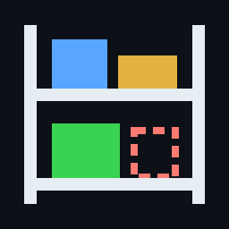
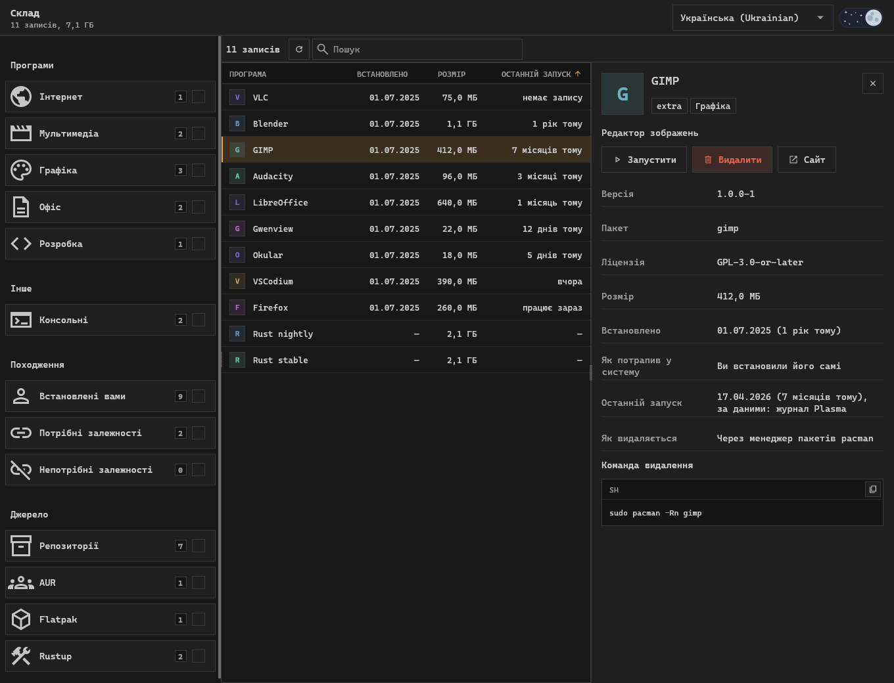
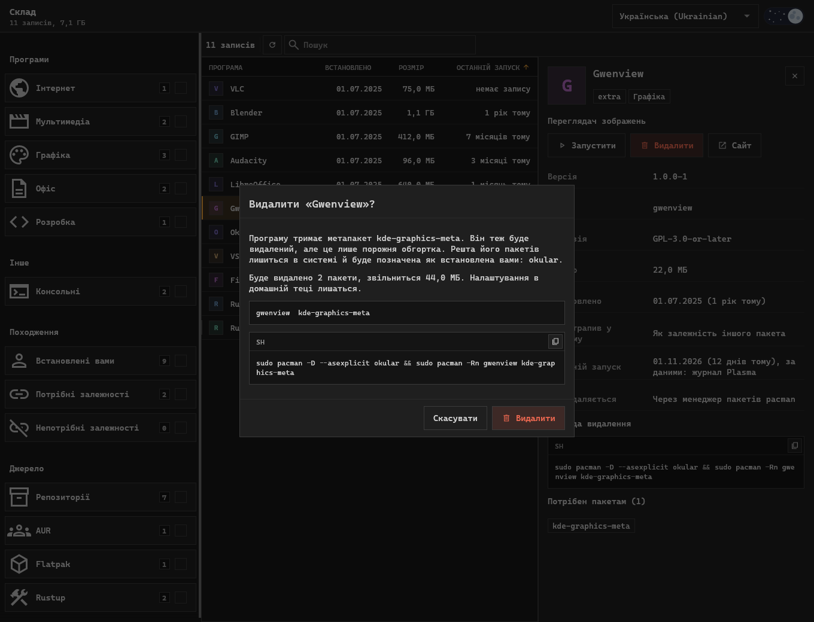
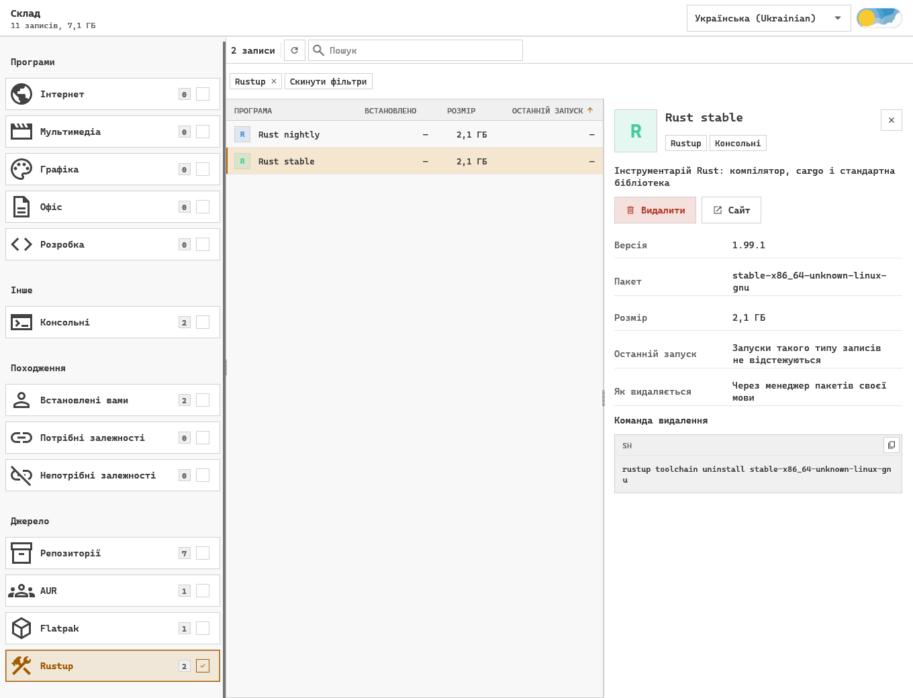

<div align="center">



# Склад

**Програма для Arch Linux, Debian і Ubuntu, яка показує все встановлене з будь-якого джерела й видаляє те, чим ви не користуєтеся.**

[](LICENSE)
[](https://github.com/pavver/sklad/actions/workflows/ci.yml)


Сайт: [English](https://pavver.github.io/sklad/) · [Українська](https://pavver.github.io/sklad/uk.html) · [Français](https://pavver.github.io/sklad/fr.html) · [Русский](https://pavver.github.io/sklad/ru.html)

Readme: [English](README.md) · **Українська** · [Français](README.fr.md) · [Русский](README.ru.md)



</div>

Менеджери пакетів знають лише те, що встановили самі.
Склад збирає в один список пакети pacman, AUR і apt, програми Flatpak, ігри Steam, інструментарії Rust, інструменти Cargo, npm і Python, середовища Python, контейнери, образи й томи Docker та файли поза менеджерами.
Відсортуйте його за останнім запуском, щоб знайти невживане, прочитайте, що це, і видаліть командою, яку видно ще до запуску.
Так зручно шукати непотрібні пакети, осиротілі залежності, забуті інструменти розробника, старі віртуальні середовища й образи Docker та звільняти місце на диску в Arch Linux, Debian і Ubuntu.

> [!WARNING]
> Рання версія.
> Тести використовують підмінений бекенд і ніколи не виконують справжнього видалення, тому читайте команду у вікні перед підтвердженням.
> Перевірено на Arch Linux із KDE Plasma на Wayland; у Debian і Ubuntu каталог і плани видалення звірено з apt у контейнерах.

## Можливості

- **Один каталог** програм, консольних інструментів, бібліотек, шрифтів, драйверів і метапакетів.
- **Не лише пакети:** проєкти Docker Compose і контейнери, кожен одним рядком разом з образами й томами, які використовує лише він, і видаляється разом з ними, а образи й томи, якими ніхто не користується, видно як залишки; та середовища Python від virtualenvwrapper, pyenv, conda і mamba.
- **Подробиці про кожен запис:** іконка, опис, ліцензія, сайт, розробник, розмір, дата встановлення.
- **Останній запуск** із журналу Plasma і Steam, щоб побачити, чим ви більше не користуєтесь.
- **Фільтри** плитками на бічній панелі, кожна з числом записів, які вона покаже: розділи, джерела і походження (встановлені вами, потрібні залежності, непотрібні). Увімкнені фільтри видно чіпами над списком, поруч із пошуком.
- **Видалення з метапакета:** програма йде, решта метапакета лишається.
- **Нічого прихованого:** точна команда на екрані, її можна скопіювати замість запуску.
- **Запуск** програми з її картки, а будь-який текст у вікні можна виділити й скопіювати.
- **Українська, англійська, французька й російська**, світла й темна теми.

## Що знаходить

| Джерело | Де шукає | Як видаляється запис |
| --- | --- | --- |
| Репозиторії, AUR | база pacman | `pacman -Rn` із перевіреним списком |
| Репозиторії, локальні пакети | база dpkg і apt для назви репозиторію | `apt-get remove` із перевіреним списком |
| Flatpak | системні й користувацькі встановлення | `flatpak uninstall`, для системних із паролем |
| Steam | маніфести бібліотеки | відкривається клієнт Steam і питає сам |
| Cargo | записи `cargo install` | `cargo uninstall` |
| Node.js | глобальні пакети npm і pnpm | `npm uninstall -g`, `pnpm remove -g` |
| Python | `pip --user`, pipx, інструменти й інтерпретатори uv | менеджер, який це встановив |
| Середовища Python | середовища virtualenvwrapper, pyenv, conda і mamba | уся тека в кошик |
| Rustup | інструментарії | `rustup toolchain uninstall` |
| Docker | контейнери, образи й томи | `docker container rm`, `docker image rm`, `docker volume rm` |
| Поза менеджерами | `~/.local/bin`, `/usr/local/bin`, `/opt`, ваші ярлики | файли з домашньої теки в кошик, системні безповоротно |

Записи Python у системній теці, якими не володіє жоден пакет, показуються, але видалення звідси вимкнено.

## Безпечне видалення



1. Список пакетів обчислюється за графом залежностей за тими самими правилами, що й `pacman -Rs` або `apt-get remove --auto-remove`.
2. Метапакет видаляється разом із програмою.
   Решта його пакетів позначається як встановлені вами і лишається в системі.
3. Перед видаленням `pacman -Rp` або `apt-get -s remove` перевіряє список.
   Якщо він не збігається, дія зупиняється.
4. Менеджер пакетів отримує пакети поіменно, тому видаляється лише те, що показано у вікні.
5. Для важливих системних пакетів і файлів поза домашньою текою потрібне окреме підтвердження.

## Інструменти мов



Інструментарії й глобальні пакети займають гігабайти, але не потрапляють у жоден список пакетів.
Склад показує їх поруч з усім іншим і попереджає перед видаленням того, на що спираються інші, як-от типовий інструментарій Rust.

## Встановлення

### Arch Linux

Склад має власний репозиторій pacman, пакети в ньому підписано ключем `EB0FE0C7F0FEBBD1A40F8F93A7A3ED14D1C98D8D`.
Один раз довірте цей ключ:

```sh
curl -sL https://pavver.github.io/sklad/sklad.asc | sudo pacman-key --add -
sudo pacman-key --lsign-key EB0FE0C7F0FEBBD1A40F8F93A7A3ED14D1C98D8D
```

Додайте репозиторій у `/etc/pacman.conf`; якщо він там уже є, команда нічого не змінить:

```sh
grep -q '^\[sklad\]' /etc/pacman.conf ||
  printf '\n[sklad]\nServer = https://pavver.github.io/sklad/$arch\n' | sudo tee -a /etc/pacman.conf >/dev/null
```

І встановіть; оновлення прийдуть разом із `pacman -Syu`:

```sh
sudo pacman -Sy sklad
```

### Debian і Ubuntu

Склад має власний репозиторій apt, підписаний тим самим ключем.
Потрібні Debian 12, Ubuntu 22.04 або новіші.
Довірте ключ і додайте репозиторій; повторний запуск команд нічого не змінить:

```sh
curl -fsSL https://pavver.github.io/sklad/sklad.asc | sudo gpg --dearmor --yes -o /usr/share/keyrings/sklad.gpg
echo 'deb [signed-by=/usr/share/keyrings/sklad.gpg] https://pavver.github.io/sklad/debian ./' |
  sudo tee /etc/apt/sources.list.d/sklad.list >/dev/null
```

І встановіть; оновлення прийдуть разом із `apt upgrade`:

```sh
sudo apt update && sudo apt install sklad
```

### Із коду

Потрібен Rust; для видалень із паролем потрібен `polkit`.

```sh
git clone https://github.com/pavver/sklad
cd sklad
cargo install --path .
install -Dm644 packaging/sklad.desktop ~/.local/share/applications/sklad.desktop
install -Dm644 assets/sklad.svg ~/.local/share/icons/hicolor/scalable/apps/sklad.svg
```

Або запустіть без встановлення:

```sh
cargo run --release
```

## Порівняно з іншими інструментами

- `pacman -Qdtq` і `apt autoremove` знаходять осиротілі залежності, але не програми, які ви встановили й закинули.
- Pamac, Octopi і Synaptic керують пакетами дистрибутива; Склад показує ще й Flatpak, Steam та менеджери пакетів мов і сортує все за останнім запуском.
- BleachBit чистить кеші й тимчасові файли; Склад видаляє програми цілком тим менеджером, який їх встановив.

## Варто знати

- Plasma записує лише запуски через меню, панель і KRunner, тому «немає запису» не означає, що програмою не користуються.
  Запуски консольних програм не відстежуються.
- Розмір показано за файлами.
  На файловій системі зі стисненням, як-от ZFS, звільниться менше.
- Мова береться із системи.
  Вибір мови в заголовку перемикає її й запам'ятовує в `~/.config/sklad/language`.
  Мову можна знайти за її власною назвою або за англійською.
  Описи йдуть за мовою, тому каталог зчитується знову.

## Участь у розробці

Зміни приймаються через pull request, див. [CONTRIBUTING.md](CONTRIBUTING.md).

## Ліцензія

[MIT](LICENSE).
Інтерфейс побудовано на дизайн-системі [Operator UI](https://github.com/pavver/operator-design-system).
Сторонні ресурси (шрифт Cascadia Code, іконки Material Symbols, перемикач дня й ночі) мають власні ліцензії, перелічені в [NOTICE.md](NOTICE.md).
